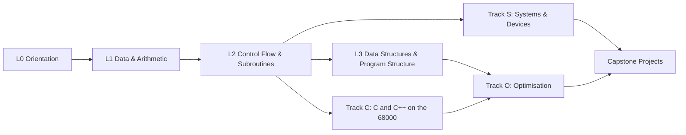

# EASy68K Learning Path — Education Strategy

> Status: **approved** (2026-10-13). Decisions are recorded in section 9.

## 1. Purpose

Give learners one continuous path from "what is a register?" to writing
cycle-optimised 68000 code, both by hand in assembly and through C/C++
compilers, using EASy68K-Qt as the laboratory. The examples should be the
best way to learn the 68000 and also the best way to understand what a C/C++
compiler does to your code.

### Audiences

| Persona | Starts at | Wants |
|---------|-----------|-------|
| **Beginner** (no assembly, maybe little programming) | Level 0 | See how a computer works one instruction at a time |
| **Computer-organisation student** (typical EASy68K course user) | Level 1 | Course-aligned exercises: data, control flow, subroutines, I/O, exceptions |
| **C/C++ developer** | Level 2 + Track C | Understand calling conventions, codegen, cost of language features |
| **Embedded / retro developer** | Level 3 | Interrupts, devices, memory maps, startup code, a tiny kernel |
| **Optimiser / demoscener** | Level 4 | Cycle-exact tuning, tricks, comparing hand code with compiler output |

## 2. Principles

1. **Runnable, always.** Every example assembles (or compiles) and runs in
   EASy68K-Qt with no edits. The defaults are the EASy68K conventions:
   `ORG $1000`, `START`, `SIMHALT`/task 9, and Trap #15 for I/O.
2. **Self-checking.** Every example carries a machine-readable spec (expected
   registers, memory, output and cycle budget). CI runs all of them headlessly
   on the simulator core, so the examples cannot rot and also serve as
   end-to-end tests of the port.
3. **One new idea per example.** Each example introduces a single concept and
   reuses only what came before; prerequisites are explicit.
4. **Predict, run, observe, explain.** Every README asks the learner to predict
   an outcome (a flag, a register, a cycle count) before running it, then shows
   where to look in the simulator (register window, memory window, stack window,
   execution log, cycle counter).
5. **Show the machine.** Lean on what the simulator exposes: flags, the stack,
   exception frames (including address and bus errors), interrupts, the
   hardware window, the memory map and exact cycle counts.
6. **Cycles are the currency of optimisation.** Optimisation lessons are
   naive-vs-optimised pairs with measured cycles, using the simulator's
   cycle counter (Trap #15 tasks 30/31, which match the original's timing).
7. **Bridge C/C++ and assembly in both directions.** Write it in C, read the
   generated 68000 code, then hand-optimise it and call it back from C.
8. **Faithful to EASy68K.** Examples use only features the original supports
   (plus the C/C++ track, which needs an external compiler). Anything
   port-specific is marked.

## 3. Structure: tracks × levels



* **Core path (Levels 0–3)**: everyone takes it; this is pure assembly.
* **Track S (Systems)**: I/O, devices, exceptions, interrupts, protection.
* **Track C (C/C++)**: freestanding C and C++ compiled for the 68000.
* **Track O (Optimisation)**: performance work in assembly and C/C++.
* **Capstones**: integrative projects.

Difficulty badges: ● basic, ●● intermediate, ●●● advanced, ●●●● expert.

## 4. Curriculum

The IDs below are stable names used in directories and cross-references.

### Level 0 — Orientation ●

| ID | Example | Concepts | Watch in the simulator |
|----|---------|----------|------------------------|
| L0-01 | `hello-simhalt` | Program skeleton: ORG, START, END, SIMHALT | PC, the listing view |
| L0-02 | `registers` | MOVEQ/MOVE to D and A registers | Register window |
| L0-03 | `memory` | DC/DS, MOVE to and from memory, big-endian layout | Memory window |
| L0-04 | `hello-world` | Trap #15 tasks 13/14, strings, LEA | Output window |
| L0-05 | `reading-the-listing` | .L68 listing, addresses, opcodes, S-records | Listing, EASyBIN |
| L0-06 | `stepping` | Step / Trace / Run / breakpoints / Rewind | Toolbar, breakpoint gutter |

### Level 1 — Data & Arithmetic ●–●●

| ID | Example | Concepts |
|----|---------|----------|
| L1-01 | `sizes` | .B/.W/.L, sign extension, EXT, partial register updates |
| L1-02 | `flags` | CCR: N Z V C X; predict the flags for ADD/SUB/CMP |
| L1-03 | `signed-unsigned` | Two's complement, overflow vs carry |
| L1-04 | `multiword` | 64-bit add/sub with ADDX/SUBX and the X flag |
| L1-05 | `mul-div` | MULU/MULS/DIVU/DIVS, remainders, divide by zero (exception preview) |
| L1-06 | `logic-bits` | AND/OR/EOR/NOT, BTST/BSET/BCLR/BCHG, masks |
| L1-07 | `shifts-rotates` | ASL/ASR/LSL/LSR/ROL/ROR/ROXL/ROXR; multiply/divide by 2^n |
| L1-08 | `bcd` | ABCD/SBCD/NBCD, decimal display |
| L1-09 | `number-io` | Trap #15 tasks 3/4/15/17/20; radix conversion by hand vs task 15 |

### Level 2 — Control Flow & Subroutines ●●

| ID | Example | Concepts |
|----|---------|----------|
| L2-01 | `compare-branch` | CMP/TST and all 14 Bcc conditions; signed vs unsigned branches |
| L2-02 | `loops-dbra` | DBRA/DBcc, loop counters, off-by-one traps |
| L2-03 | `structured` | EASy68K IF/ELSE/ENDI, WHILE, REPEAT, FOR, DBLOOP; inspect the generated code |
| L2-04 | `subroutines` | BSR/JSR/RTS, return addresses on the stack |
| L2-05 | `parameters` | Registers vs stack parameters; saving registers with MOVEM |
| L2-06 | `stack-frames` | LINK/UNLK, locals, frame pointer; Stack window |
| L2-07 | `recursion` | Factorial and Fibonacci; stack growth, cost |
| L2-08 | `jump-tables` | Computed JMP, d(PC,Xi), switch statements |

### Level 3 — Data Structures & Program Structure ●●–●●●

| ID | Example | Concepts |
|----|---------|----------|
| L3-01 | `addressing-modes` | All 12 modes side by side with cycle costs |
| L3-02 | `arrays` | Indexing with (An)+, d(An,Xi); 2-D arrays |
| L3-03 | `strings` | Length, copy, compare, reverse, upper-case; null- vs length-prefixed |
| L3-04 | `sorting` | Bubble → insertion → quicksort, with cycle comparison |
| L3-05 | `searching` | Linear vs binary search |
| L3-06 | `linked-lists` | Nodes, insert/delete, pointer chasing |
| L3-07 | `stack-queue` | Ring buffers, -(An)/(An)+ stacks |
| L3-08 | `macros` | MACRO/ENDM, parameters, \@, NARG, building a mini-library |
| L3-09 | `conditional-assembly` | IFEQ/IFNE…, debug builds, OPT/listing control |
| L3-10 | `multi-file` | INCLUDE, INCBIN, SECTION/OFFSET for structs |
| L3-11 | `position-independence` | PC-relative code, relocatable routines |

### Track S — Systems & Devices ●●–●●●●

| ID | Example | Concepts | Original feature |
|----|---------|----------|------------------|
| S-01 | `text-io-advanced` | Cursor, colours, keyboard state, input modes (tasks 11, 12, 16, 19, 21) | Output window |
| S-02 | `file-io` | Open/read/write/seek/close, file dialogs (tasks 50–59) | File I/O |
| S-03 | `graphics-basics` | Pixels, lines, rectangles, ellipses, fill, pen (tasks 80–96) | Graphics |
| S-04 | `double-buffering` | Animation without flicker (task 92 modes, task 94 repaint) | Graphics |
| S-05 | `sound` | Play/stop and multi-voice (tasks 70–77) | Sound |
| S-06 | `timing` | Task 8 time, task 23 delay, frame pacing | Timers |
| S-07 | `hardware-window` | 7-segment display, LEDs, switches, push buttons (task 32) | Hardware window |
| S-08 | `exceptions` | Vector table, TRAP #n handlers, CHK, TRAPV, divide by zero, illegal | Exceptions |
| S-09 | `address-bus-errors` | Odd addresses, class 0 frames, recovery | Address/bus error |
| S-10 | `interrupts` | Autovectors, IRQ buttons and auto-IRQ, interrupt masks, STOP | Interrupts |
| S-11 | `supervisor-user` | Privilege, USP/SSP, RTE, privilege violation | CPU modes |
| S-12 | `memory-map` | ROM/Read/Protected/Invalid ranges, MEMORY directive | Memory map |
| S-13 | `mouse-keyboard-irq` | Peripheral IRQs (tasks 60–62) | Peripheral I/O |
| S-14 | `serial` | COM ports (tasks 40–43), loopback | Serial (optional build) |
| S-15 | `network` | TCP/UDP client/server (tasks 100–107) | Network |
| S-16 | `logging-debugging` | Execution log, advanced breakpoints, run-to-cursor | Debugger |

### Track C — C and C++ on the 68000 ●●–●●●●

Toolchain: GCC cross-compiler (`m68k-linux-gnu-gcc`, available on Debian/
Ubuntu; `m68k-elf-gcc` elsewhere) used freestanding: `-m68000
-ffreestanding -nostdlib`, a linker script placing code at $1000, and
`objcopy -O srec` to produce an `.S68` the simulator loads. A tiny runtime,
**libeasy68k**, maps C calls onto Trap #15 tasks (text, input, graphics,
sound, files, time).

| ID | Example | Concepts |
|----|---------|----------|
| C-01 | `toolchain` | crt0 (stack setup, BSS clear, call main, exit via task 9), linker script, S-records |
| C-02 | `types-on-68000` | int/short/long/pointer sizes, alignment, endianness, `sizeof` |
| C-03 | `calling-convention` | Arguments on the stack, return in D0, scratch D0–D1/A0–A1, saved D2–D7/A2–A6, frame pointer |
| C-04 | `reading-compiler-output` | `-S` at -O0/-O1/-O2/-Os; mapping C lines to instructions |
| C-05 | `pointers-arrays` | Pointer arithmetic ↔ addressing modes; `volatile` and memory-mapped I/O |
| C-06 | `structs-unions` | Layout and padding, bitfields vs masks, OFFSET-based asm views |
| C-07 | `libeasy68k` | Writing the Trap #15 runtime: inline asm with constraints |
| C-08 | `c-calls-asm` | Hand-written asm functions called from C (and back) |
| C-09 | `interrupts-in-c` | ISRs in C with an asm wrapper, critical sections, `volatile` |
| C-10 | `cpp-classes` | Freestanding C++17: classes, constructors, RAII; no exceptions/RTTI |
| C-11 | `cpp-virtual` | Virtual dispatch and vtables in memory; cost in cycles |
| C-12 | `cpp-templates-constexpr` | Templates, `constexpr`, zero-cost abstractions verified by cycle count |
| C-13 | `cpp-embedded-patterns` | Placement new, static allocation, CRTP drivers for the hardware window |

### Track O — Optimisation ●●●–●●●●

Each lesson is a pair: `naive` and `optimised`, with the same functional spec
and a cycle budget the optimised version must meet.

| ID | Example | Techniques |
|----|---------|------------|
| O-01 | `measuring` | Cycle counter (tasks 30/31), execution log, why measure first |
| O-02 | `instruction-selection` | MOVEQ/ADDQ/SUBQ/LEA/CLR choices, quick forms, EA costs |
| O-03 | `addressing-costs` | Register vs memory operands; d(An) vs (An)+ vs absolute |
| O-04 | `loops` | DBRA, loop inversion, unrolling, Duff's device |
| O-05 | `block-memory` | MOVEM for copy and fill, long vs word transfers |
| O-06 | `multiply-divide-free` | Shifts and adds, reciprocal multiplication, avoiding DIVS |
| O-07 | `lookup-tables` | Trade memory for cycles (sine, popcount, CRC) |
| O-08 | `fixed-point` | 16.16 maths, MULS-based scaling |
| O-09 | `branchless` | Scc, masks, conditional moves without branches |
| O-10 | `register-allocation` | Keeping hot values in registers, MOVEM save/restore minimisation |
| O-11 | `compiler-vs-hand` | Same algorithm: C at -O2/-Os vs hand asm; reading and beating the compiler |
| O-12 | `c-optimisation` | Writing C that compiles well on the 68000 (types, `restrict`, loop forms) |
| O-13 | `graphics-fast-paths` | Fast line/fill routines, double buffering, frame budgets |

### Capstone projects ●●●–●●●●

| ID | Project | Draws on |
|----|---------|----------|
| P-01 | **Calculator** (RPN, BCD or fixed point) | L1–L3, S-01 |
| P-02 | **Snake / Pong** (graphics, keyboard, timer IRQ, sound) | S-03..S-10, O-13 |
| P-03 | **Mini monitor/debugger** (memory dump, edit, go; TRAP-based) | L3, S-08, S-11 |
| P-04 | **Forth interpreter** in assembly | L2–L3, O |
| P-05 | **Preemptive mini-kernel** (tasks, context switch on timer IRQ, user/supervisor, protected memory) | S-08..S-12, C-09 |
| P-06 | **C++ game framework** on libeasy68k, with hand-optimised asm hot paths | Track C, Track O |
| P-07 | **Demo effect** (plasma/rotozoom in fixed point within a cycle budget) | O-07, O-08, O-13 |

## 5. Example anatomy

Every example lives in its own directory with the same layout:

```
examples/
  core/L2-06-stack-frames/
    README.md        # goal, prerequisites, concepts, predict/run/observe/explain,
                     # what to watch, exercises, further reading (Help pages)
    main.x68         # the program (or main.c / main.cpp in Track C)
    example.toml     # machine-readable spec (see below)
    exercises/       # starter files for exercises
    solutions/       # reference solutions (also verified by CI)
```

**`example.toml`** (verification spec, consumed by the example runner):

```toml
id = "L2-06"
title = "Stack frames with LINK/UNLK"
level = 2
track = "core"
difficulty = 2
requires = ["L2-04", "L2-05"]
source = "main.x68"            # or main.c (+ toolchain = "gcc-m68k")
max_instructions = 100000

[expect]
halted = true                  # SIMHALT or task 9
output = "Result: 120\r\n"      # Trap #15 text output
registers = { D0 = 0x78 }
memory = [ { address = 0x2000, bytes = "00 78" } ]
max_cycles = 2400              # performance budget (Track O: required)

[input]                        # scripted keyboard input for tasks 2/4/5
text = ["5"]
```

**README template** (identical sections in every example): *Goal*,
*Prerequisites*, *New concepts*, *Predict* (questions before running),
*Run & observe* (which windows and which values), *Explain* (what happened
and why), *Common mistakes* (for example odd-address word access leading to
an address error), *Exercises* (graded, with hints), *Going further*.

## 6. Verification and tooling

| Piece | Purpose | Depends on |
|-------|---------|------------|
| **`easy68k-run`** (headless CLI) | Assemble or load, run with scripted input, emit registers/memory/output/cycles as JSON | Core libraries (Phase 9) |
| **Example runner test** | Iterates over `examples/**/example.toml`, runs each `main` and each solution, checks the spec | `easy68k-run`, CTest |
| **CMake option `BUILD_EXAMPLES_C`** | Builds Track C with the cross-compiler when it is found; skipped otherwise | gcc-m68k toolchain |
| **libeasy68k** | C runtime over Trap #15 (+ crt0 and linker script) | Track C |
| **CI** | Runs all examples on Linux/macOS/Windows; cycle budgets catch regressions in the simulator's timing | Phase 12 |

The examples double as a large, realistic regression suite for the
assembler and simulator. For example, a parity bug in branch sizing or cycle
timing shows up as a failing example.

## 7. In-application experience (post-parity)

Parity comes first; these are additions after it, behind the same menus as the
original:

* Edit68K **File → Examples…** browser (filter by level and track; open the
  example plus its README).
* Sim68K shows the example's "what to watch" hints and can check results
  against `example.toml` ("Check my solution").
* The Help system links each instruction page to the examples that use it.

## 8. Roadmap

| Phase | Deliverable | Prerequisite |
|-------|-------------|--------------|
| E0 | This strategy approved; directory skeleton, templates, `example.toml` schema | — |
| E1 | `easy68k-run` CLI + example runner test | Phase 9 core complete |
| E2 | Level 0–1 (15 examples) | E1 |
| E3 | Level 2–3 (19 examples) | E2 |
| E4 | Track S (16) | E3; GUI back ends for graphics/sound/hardware examples (Phase 13) |
| E5 | Track C toolchain, libeasy68k, C-01..C-09 (in parallel with E2–E3) | E1, cross-compiler |
| E6 | Track C++ C-10..C-13 | E5 |
| E7 | Track O (13 naive/optimised pairs) | E3, E5 |
| E8 | Capstones | E4–E7 |
| E9 | In-app examples browser and solution checker | Phase 13 parity |

Examples that only need text I/O (most of Levels 0–3, Track C, Track O) can be
verified headlessly as soon as E1 lands. Graphics, sound and hardware-window
examples are written with E4 but are checked visually until the Qt back ends
exist.

## 9. Decisions (approved 2026-10-13)

1. **Location.** Runnable examples live in top-level `examples/` and ship with
   the applications; this strategy and the spec format live in `doc/examples/`.
2. **C/C++ toolchain.** GCC cross-compiler (`m68k-linux-gnu-gcc` /
   `m68k-elf-gcc`) is the reference compiler: C11 and freestanding C++17.
   vbcc may be added later as a secondary compiler.
3. **Licensing.** Examples are dedicated to the public domain under
   **CC0 1.0 Universal** (SPDX `CC0-1.0`) so learners can reuse them freely.
   The applications remain under the GNU GPL (repository root `LICENSE`).
4. **Ordering.** The core path (Levels 0–3) and Track C are developed in
   parallel.
5. **First increment.** E0–E2: skeleton, templates and spec format (E0);
   `easy68k-run` and the example runner (E1); Levels 0–1 (E2).
